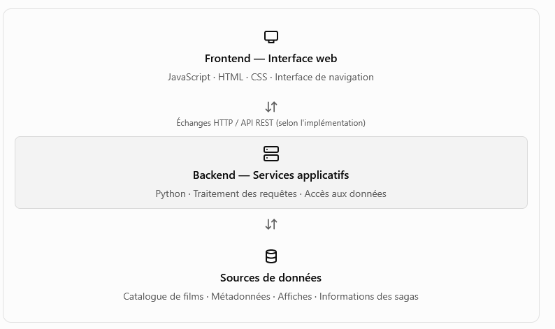

# TinyMovieCatalog

 

Application locale de gestion de bibliotheques de films (MKV/MP4).
TinyMovieCatalog est une application web de catalogue cinématographique organisée autour d'un Frontend JavaScript et d'un Backend Python. Elle propose plusieurs modes de consultation d'une bibliothèque de films, dont un affichage visuel par vignettes, une vue technique et un regroupement par sagas avec navigation horizontale.

## Fonctionnalités principales:
- **Bibliothèque de films** : centralisation de l’ensemble des films de la collection.
- **Affichage par Vignettes** : présentation visuelle des films sous forme d’affiches.
- **Affichage Technique** : consultation des informations techniques et détaillées des films.
- **Affichage par Saga** : regroupement automatique des films appartenant à une même saga.
- **Recherche et navigation** : accès rapide aux films et aux différentes catégories de la bibliothèque.
- **Fiches détaillées** : sélection d’un film pour consulter ses informations et son contenu.
- **Gestion des collections** : organisation de la bibliothèque autour des films et de leurs sagas.
- **Interface orientée médiathèque** : priorité donnée aux visuels, aux affiches et à une navigation simple et intuitive.


## Architecture / Langages: 

TinyMovieCatalog est une application web destinée à gérer, organiser et consulter une bibliothèque personnelle de films à travers une interface graphique de type médiathèque.
L'application repose sur une architecture séparant le Frontend, chargé de l'interface utilisateur, et le Backend, responsable du traitement des données et de la logique applicative.

- **Frontend** : Angular 19 (standalone components)
- **Backend** : Python (FastAPI) — scan des dossiers, analyse video via FFmpeg/ffprobe, enrichissement TheMovieDB, base SQLite locale
- **Usage 100% local**, aucune authentification


 


**Frontend**
Le dossier frontend/ contient l'application destinée à l'utilisateur.
Ses responsabilités sont notamment :
- Afficher les films sous forme de vignettes avec leurs affiches.
- Présenter les informations techniques des films.
- Proposer les différents modes d'affichage.
- Organiser les films par saga.
- Gérer la navigation, les interactions et le défilement horizontal des collections.
- Communiquer avec le Backend pour récupérer les données nécessaires.
L'installation des dépendances JavaScript est réalisée avec npm install. Le lancement de l'application de développement est prévu avec npm start, selon la configuration du projet.

**Backend**

Le dossier backend/ contient les services Python chargés de la logique applicative.
Ses responsabilités fonctionnelles peuvent comprendre :
- Fournir les données du catalogue au Frontend.
- Lire et traiter les informations des films.
- Regrouper les films appartenant à une même saga.
- Transmettre les métadonnées et les chemins des affiches.
- Centraliser les traitements nécessaires à la consultation du catalogue.
L'environnement Python est préparé avec un environnement virtuel .venv, puis les dépendances sont installées à partir de requirements.txt.


## Organisation des dossiers projets:

```
project/
├── backend/          API Python (FastAPI)
│   ├── app/
│   ├── data/          <- base SQLite + vignettes (partage entre bibliotheques)
│   ├── requirements.txt
│   └── .env.example
└── frontend/         Application Angular
    └── src/
```

## Systemes d'exploitation:

- Windows 10 / Windows 11
- Linux
- macOS


## Structure de dossiers de bibliotheque attendue
Exemple de structure de dossiers
```
C:\MesFilms                              (ou /home/user/MesFilms sous Linux)
├── Inception (2010)\
│   ├── Inception.mkv
│   └── Inception.fr.srt        (optionnel)
├── Interstellar (2014)\
│   └── Interstellar.mkv
└── ...
```

<span style="color:red">IMPORTANT</span>: Chaque film doit être dans un dossier nommé</span> **Titre du film (Annee)**, contenant
obligatoirement un fichier video (`.mkv`, `.mp4`, `.avi`, `.m4v`) et, en
option, un ou plusieurs fichiers de sous-titres (`.srt`, `.ass`, `.ssa`,
`.sub`, `.vtt`).


## 1. Prérequis

| Outil | Windows | Linux | macOS |
|---|---|---|---|
| Python 3.10+ | https://www.python.org/downloads/ | `sudo apt install python3 python3-pip python3-venv` | `brew install python` |
| Node.js 18+ / npm | https://nodejs.org/ | `sudo apt install nodejs npm` (ou nvm) | `brew install node` (ou nvm) |
| FFmpeg (fournit `ffprobe`) | https://www.gyan.dev/ffmpeg/builds/ (ajouter `bin\` au PATH) | `sudo apt install ffmpeg` | `brew install ffmpeg` |
| Angular CLI | `npm install -g @angular/cli` | `npm install -g @angular/cli` | `npm install -g @angular/cli` |

*Note pour MacOS: Homebrew doit être installé au préalable (https://brew.sh). Sur macOS, brew install python installe la dernière version stable de Python 3, et python3 / pip3 sont alors disponibles dans le PATH.*

Vous aurez également besoin d'une **clé API TheMovieDB** (gratuite) :
https://www.themoviedb.org/settings/api

---

<span style="color:darkgreen">**Astuce installation et lancement RAPIDE pour LINUX**</span>

```bash
chmod +x *.sh
./install.sh
./start.sh
```
sinon suivre les étapes suivantes voir chapitre Installation et lancement (backend + frontend) 


## 2. Installation et démarrage
Le projet utilise deux environnements de dépendances distincts.


**Étape 1 — Installer le Frontend**
```bash
# Linux / macOS / Windows
cd frontend
npm install
```

**Étape 2 — Installer le Backend**

Copiez le fichier exemple `.env.example` en `.env`, puis edtiez le fichier de configuration `backend/.env` :

```ini
TMDB_API_KEY=votre_cle_ici
TMDB_LANGUAGE=fr-FR
FFPROBE_PATH=ffprobe   # ou chemin complet si ffprobe n'est pas dans le PATH
FFPLAY_PATH=ffplay     # utilise par le bouton PLAY (ou chemin complet si ffplay n'est pas dans le PATH)
```

```bash
#  Linux / macOS
cd backend
python3 -m venv venv
venv\Scripts\activate
pip install -r requirements.txt
```

```bash
#  Windows
cd backend
python -m venv venv
source venv/bin/activate                 
pip install -r requirements.txt
```

**Étape 3 — Démarrer les services**

Le Frontend et le Backend doivent être lancés selon leurs scripts et points d'entrée respectifs. Il faut éviter qu'un processus interactif comme npm start bloque l'exécution des commandes suivantes dans un script d'installation.

Pour automatiser le démarrage, il est préférable de séparer l'installation des dépendances du lancement des services, puis d'utiliser deux processus distincts ou un mécanisme d'orchestration adapté.


**lancement frontend**
```bash
cd frontend
npm run start
```

**lancement backend**
```bash
# Linux / macOS
cd backend
source venv/bin/activate                 
uvicorn app.main:app --reload --port 8000
```

```bash
#  Windows
cd backend
 .venv\Scripts\Activate.ps1               
uvicorn app.main:app --reload --port 8000
```


L'application est disponible sur le lien 'http://localhost:4200'


La documentation des API est disponible Swagger sur `http://localhost:8000/docs`.
Les API backend sont accèssibles depuis l'URL: http://localhost:8000

Pour information, l'URL de l'API est définie dans `src/environments/environment.ts`
(apiUrl: 'http://localhost:8000/api'). Modifiez-la si votre backend tourne sur une autre machine/port.


Puis suivre les étapes ci-dessous:
1. L'application est disponible sur `http://localhost:4200` en mode developement ou `http://localhost:3000` en mode build (npm build au préalable)

2. Dans le panneau de gauche, cliquez sur **"+ Nouvelle bibliotheque"**, donnez-lui
   un nom et indiquez le chemin du dossier racine (ex. `C:\movies` ou
   `/home/user/movie`).
3. Cliquez sur l'icone **⟳** a cote de la bibliotheque pour lancer un scan :
   - détection des dossiers de films,
   - analyse du fichier video via `ffprobe` (codec, résolution, pistes audio),
   - recherche TheMovieDB (titre original, acteurs, affiche),
   - téléchargement de l'affiche dans `backend/data/thumbnails/` (dossier
     commun a toutes les bibliothèques).
4. Basculez entre les bibliotheques via le panneau de gauche.
5. Quatre vues sont disponibles en haut de la page :
   - **Vignettes** : grille d'affiches avec recherche, clic pour voir le detail
     (synopsis, distribution, pistes audio, sous-titres).
   - **Genre** : Explorez tous vos films classés par genre 
   - **Saga** : Liste des collection Saga avec la liste des films disponibles dans la   bibliothèques sous forme de grille
   - **Acteur / filmographie** : filmographie d'un acteur/actrice
   - **Detail technique** : tableau tri­able (nom du film, fichier, encodage,
     resolution, taille, pistes audio) avec recherche.
   - **Info** : page d'information de la bibliothèque (nom, Dossier Racine, Taille disque, Taille disponible gauge d'utilisation)
   - **Comparaison** (bouton **Outils** du panneau de gauche) : compare deux bibliotheques (identique / manquant a droite / manquant a gauche), en comparaison simple (nom du dossier) ou approfondie (nom et taille du fichier video). La comparaison s'appuie sur le dernier scan de chaque bibliotheque.
     

Relancer un scan met a jour les films existants et retire de la base ceux
dont le dossier a ete supprime du disque (les fichiers eux-memes ne sont
jamais modifies ni supprimes par l'application).


# Notes techniques

- La base **SQLite** est stockée dans `backend/data/db/library.db`.
- Les affiches sont stockées dans `backend/data/thumbnails/` et nommées
  `tmdb_<id>.jpg` : elles sont donc partagées et dédupliquées entre toutes
  les bibliothèques qui referencent le meme film.
- Le scan est synchrone (la requete HTTP attend la fin du scan) : pour de
  très grosses bibliothèques (>500 films), prevoir un temps de reponse
  proportionnel au nombre de films et a la latence de l'API TMDb.
- Si `ffprobe` est introuvable, le film est tout de meme ajoute (dossier +
  nom de fichier + taille) mais sans les details video/audio ; un message
  d'erreur associé est renvoyé dans le résultat du scan.
- Sans cle TMDb configurée, le scan fonctionne normalement mais aucune
  affiche/metadonnée (acteurs, synopsis...) n'est récuperée.


# Fonctionalités techniques
- Les scans de bibliotheques sont lancés en tâche de fond et ne bloquent pas la requete HTTP.
- La progression du scan est poussée au frontend via WebSocket avec une barre de progression et le dossier en cours.
- Le bandeau supérieur affiche le nom de la bibliotheque active en gras et son nombre total de films.
- Scan en arriere-plan (tache asynchrone + barre de progression / websocket)
- Detection/rapprochement manuel quand TMDb ne trouve pas de correspondance
- Correction manuelle des informations TMDb
Depuis la fiche d’un film, le bouton **Modifier les informations** lance une recherche TMDb à partir du titre et de l’année du dossier. Les résultats sont affichés dans une fenêtre modale avec vignette, titre, année, titre original, genres et description. Le résultat sélectionné remplace les métadonnées TMDb du film et son affiche est enregistrée dans `backend/data/thumbnails/`. La base `backend/data/db/library.db` est mise à jour.
L’affiche précédente est supprimée automatiquement si elle n’est plus utilisée par aucun autre film.
- Comparaison simple ou approfondie entre 2 bibliothèques.


# Pistes d'evolution possibles
- Passage en multi-langues / Angular i18n
- Edition manuelle des metadonnees d'un film


# Extraire le code source uniquement pour le soumettre à l'IA 
Compresser le projet au format ZIP et exclure tous les fichiers/dossiers inutiles (et régénérés après), ceci permet d'éviter de consommer trop de tokens et d'alourdir inutilement le ZIP.

```bash
# BASH
./compress.sh

# WINDOWS POWERSHELL
./compress.ps1
```


# Scan des bibliothèques (parsing et FFprobe)

Le dialogue de scan permet de choisir la structure :
- **Simple** : dossiers de films nommés `Titre (Année)`.
- **Mixte** : dossiers de films et fichiers vidéo directement dans les répertoires parcourus.

La profondeur de parcours est configurable (0 à 20). Le parseur de noms (`backend/app/filename_parser.py`)
ne retourne que le titre candidat et l'année; les données techniques proviennent de FFprobe (`-print_format json`,
flux et conteneur réels). Les copies du même titre/année sont regroupées dans une fiche de film et chaque
emplacement vidéo est conservé séparément avec son chemin complet et son nom de fichier. Le scan n'efface
pas automatiquement les entrées devenues indisponibles et n'effectue aucune opération de déplacement,
renommage ou suppression sur les fichiers du disque.

Le statut et l'erreur de FFprobe sont conservés pour chaque fichier vidéo. Une erreur d'analyse ne bloque pas
la création de l'entrée de catalogue. Les champs techniques supplémentaires (fréquence d'images, profondeur
de couleur, informations HDR et résumé des flux) sont exposés par l'API lorsqu'ils sont disponibles.

Les tests du parseur se lancent depuis `backend/` avec `python -m unittest discover -s tests`.


# Documentations

- [Historique du projet](docs/history.md)
- [Exigences parsing organisation dossiers / fichiers](docs/parsing_ffprobe.md##1.-Principe-général)
- [Exigences ffprobe](docs/parsing_ffprobe.md##3.-Exigences-analyseur-FFprobe)